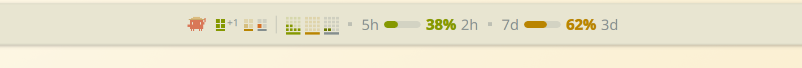
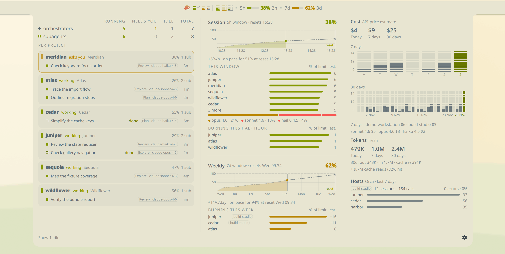

# plasma-claudebar

<picture>
  <source media="(prefers-color-scheme: dark)" srcset="docs/screenshots/panel-dark.png">
  
</picture>

A Plasma 6 panel widget for Claude Code. It centres itself on the screen and shows herdr agent counts as block stacks alongside the five-hour and weekly rate limits. Open the notch for the agent list, limit details and an estimated cost at API prices.

## Notch

<picture>
  <source media="(prefers-color-scheme: dark)" srcset="docs/screenshots/notch-dark.png">
  
</picture>

*Screenshots use demo data.*

## Install

```sh
git clone git@github.com:Aethryl/plasma-claudebar.git
cd plasma-claudebar
./install.sh
gdbus call --session -d org.kde.plasmashell -o /PlasmaShell \
  -m org.kde.PlasmaShell.evaluateScript "$(< add-to-panel.js)"
```

`install.sh` symlinks `plasmoid/` into `~/.local/share/plasma/plasmoids/io.github.aethryl.claudebar`, so edits are live. `add-to-panel.js` adds the widget to the top panel; you can also add it in edit mode. Claudebar fills the free space and centres itself, so the panel needs no spacers. After a QML change, run `systemctl --user restart plasma-plasmashell`.

## Requirements

- Plasma 6 (tested on 6.7.5)
- herdr at `~/.local/bin/herdr` for agent counts
- Claude Code with a statusline that merges `rate_limits` into `~/.cache/claude-bar/limits.json`, keeping the higher `used_percentage` per window under a file lock (see below)

Claudebar is built around one setup and reads fixed locations:

- Orca CLI state in `~/.config/orca/` (`orchestration.db`, `linux-orca-cli-shim`)
- Claude Code transcripts in `~/.claude/sessions` and `~/.claude/projects`
- its own cache in `~/.cache/claude-bar/` and settings in `~/.config/claude-bar/settings.json`
- herdr at `~/.local/bin/herdr` and the `claude` binary on `PATH` or at `~/.local/bin/claude`
- optional: [orca-fleet-stats](https://github.com/Aethryl/orca-fleet-stats) for remote host stats, found at `~/Repos/orca-fleet-stats/plugins/orca-fleet-stats/bin/orca-fleet-stats` or `$CLAUDEBAR_FLEET_STATS`

## Statusline hook

Claude Code passes `rate_limits` to the statusline command as JSON on stdin. Call a function like this from your statusline script so the widget sees the limits of every session:

```python
import fcntl, json, os, time

CACHE_DIR = os.path.expanduser("~/.cache/claude-bar")
LIMITS_CACHE = os.path.join(CACHE_DIR, "limits.json")


def cache_rate_limits(rate_limits):
    if not rate_limits:
        return
    os.makedirs(CACHE_DIR, exist_ok=True)
    with open(f"{LIMITS_CACHE}.lock", "w") as lock:
        fcntl.flock(lock, fcntl.LOCK_EX)
        try:
            with open(LIMITS_CACHE) as f:
                merged = json.load(f).get("rate_limits") or {}
        except (OSError, ValueError):
            merged = {}
        for key, window in rate_limits.items():
            old = merged.get(key) or {}
            if isinstance(window, dict) and window.get("used_percentage", 0) >= old.get("used_percentage", -1):
                merged[key] = window
        tmp = f"{LIMITS_CACHE}.{os.getpid()}.tmp"
        with open(tmp, "w") as f:
            json.dump({"updated_at": time.time(), "rate_limits": merged}, f)
        os.replace(tmp, LIMITS_CACHE)
```

## Licences

The code is MIT, see `LICENSE`.

The `clawd-*.svg` images, everything in `plasmoid/contents/images/outfits/` and the art generated by `plasmoid/contents/images/make-clawd.py` depict Claude Code's mascot, which belongs to Anthropic. They are not covered by the MIT licence and no licence to use them is granted here. Anthropic publishes no usage terms for the mascot; its general [trademark guidelines](https://www.anthropic.com/legal/trademark-guidelines) apply.
